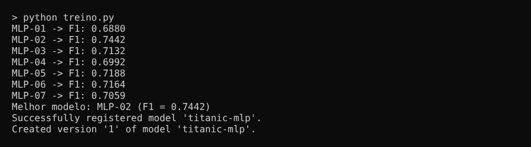
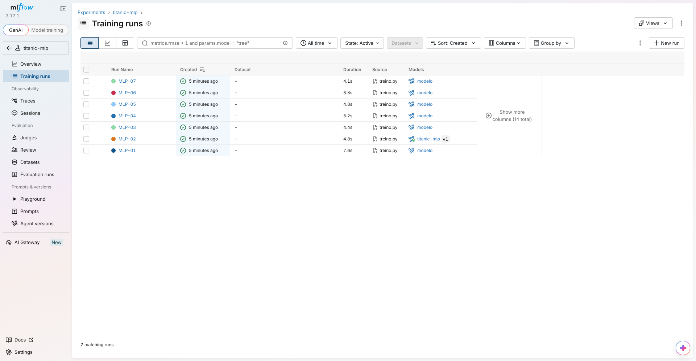
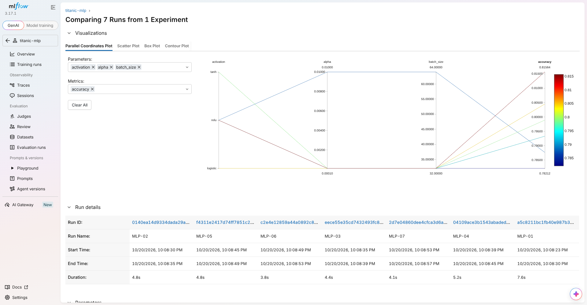
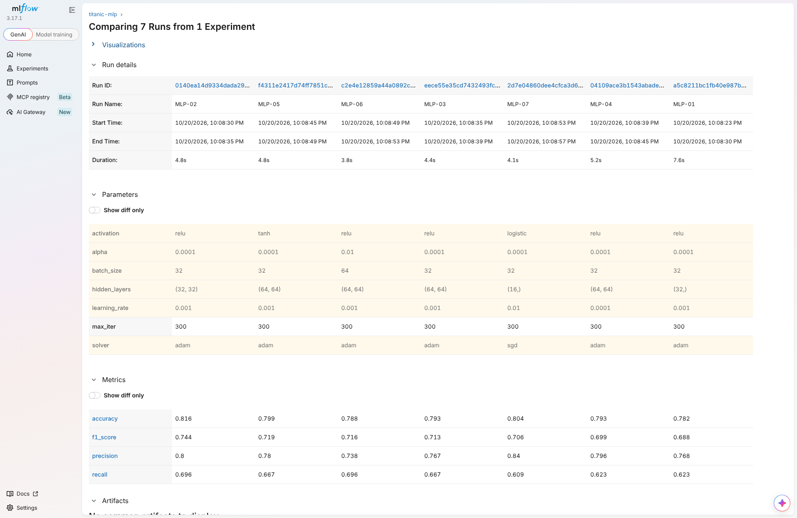
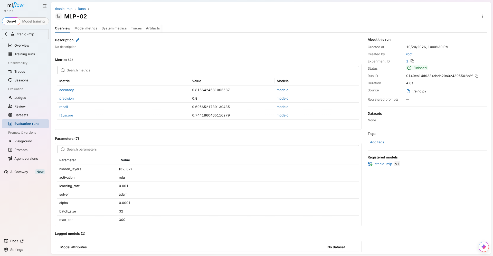
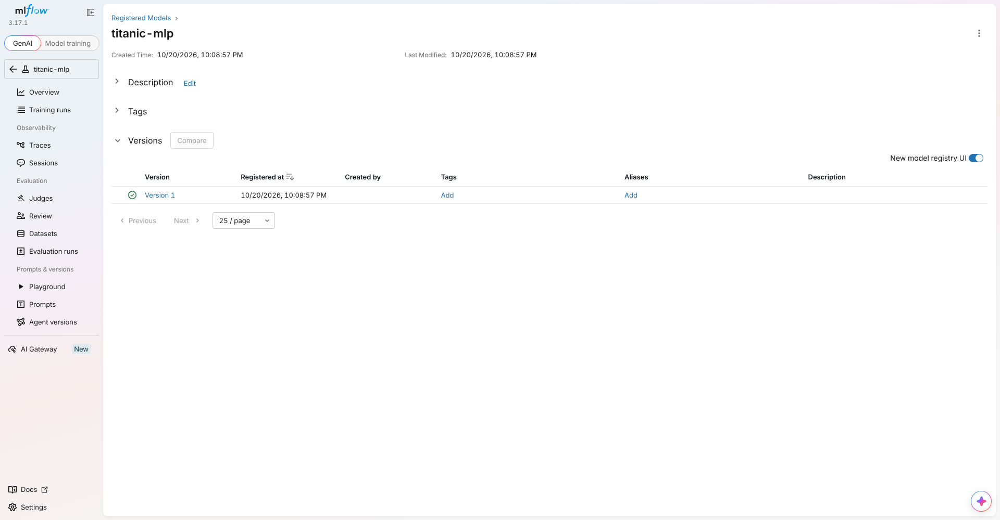
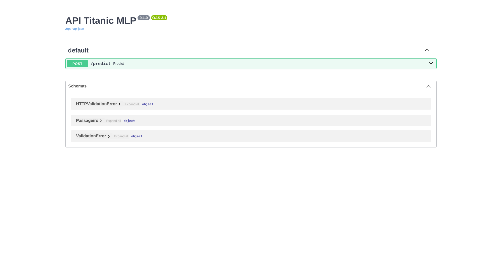
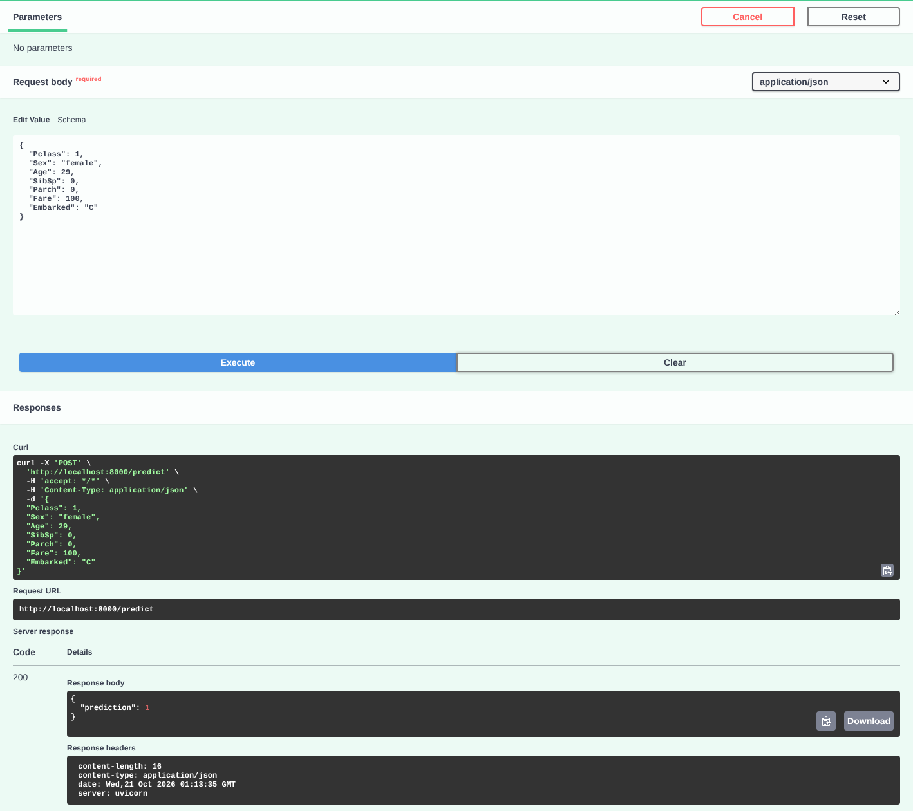

# CP4 — MLP + MLflow + API de Predição

## Integrantes
- Rodrigo Leme — RM550266
- (adicionar demais integrantes)

## Problema
**Classificação binária:** prever se um passageiro do Titanic **sobreviveu (1)** ou **não sobreviveu (0)** a partir de suas características.

- **Dataset:** Titanic (`data/titanic.csv`) — 891 passageiros
- **Target:** `Survived`
- **Features usadas:** `Pclass`, `Sex`, `Age`, `SibSp`, `Parch`, `Fare`, `Embarked`

| Feature | Significado |
|---|---|
| Pclass | Classe da passagem (1, 2 ou 3) |
| Sex | Sexo (`male` / `female`) |
| Age | Idade |
| SibSp | Nº de irmãos/cônjuges a bordo |
| Parch | Nº de pais/filhos a bordo |
| Fare | Valor pago pela passagem |
| Embarked | Porto de embarque (`C`, `Q`, `S`) |

## Estrutura
```
cp4-mlp-mlflow/
├── data/titanic.csv       # dataset
├── preprocessamento.py    # carga, split treino/teste e pré-processamento
├── treino.py              # treina os MLPs, registra no MLflow e registra o melhor modelo
├── api.py                 # API FastAPI que carrega o modelo do MLflow
├── prints/                # evidências (treino, MLflow e API)
├── requirements.txt
└── README.md
```

## Preparação dos dados (`preprocessamento.py`)
- **Seleção de features:** descartadas `PassengerId`, `Name`, `Ticket` (identificadores/texto livre) e `Cabin` (77% ausente).
- **Valores ausentes:** `Age` (177) → mediana; `Embarked` (2) → valor mais frequente.
- **Categóricas:** `Sex` e `Embarked` → One-Hot Encoding.
- **Padronização:** numéricas → `StandardScaler`.
- **Treino/teste:** 80% / 20%, estratificado pela target.

O pré-processamento e o MLP ficam no **mesmo Pipeline** do scikit-learn, salvo como artifact no MLflow. Assim, a API aplica exatamente o mesmo pré-processamento do treino nas novas predições.

## Experimentos (`treino.py`)
Foram treinadas 7 configurações de `MLPClassifier`:

| Run | Hidden Layers | Activation | Learning Rate | Solver | Alpha | Batch |
|---|---|---|---|---|---|---|
| MLP-01 | (32) | relu | 0.001 | adam | 0.0001 | 32 |
| MLP-02 | (32, 32) | relu | 0.001 | adam | 0.0001 | 32 |
| MLP-03 | (64, 64) | relu | 0.001 | adam | 0.0001 | 32 |
| MLP-04 | (64, 64) | relu | 0.0001 | adam | 0.0001 | 32 |
| MLP-05 | (64, 64) | tanh | 0.001 | adam | 0.0001 | 32 |
| MLP-06 | (64, 64) | relu | 0.001 | adam | 0.01 | 64 |
| MLP-07 | (16) | logistic | 0.01 | sgd | 0.0001 | 32 |

Em cada run o MLflow registra:
- **Parameters:** hidden_layers, activation, learning_rate, solver, alpha, batch_size, max_iter
- **Metrics:** accuracy, precision, recall, f1_score
- **Artifact:** o modelo treinado (pipeline completo)

Ao final, o run com **maior F1-score** é registrado no Model Registry do MLflow com o nome `titanic-mlp`.



## Como executar

### 1. Instalar dependências
```bash
python -m venv venv
# Windows: venv\Scripts\activate | Linux/Mac: source venv/bin/activate
python -m pip install -r requirements.txt
```

### 2. Treinar e registrar os experimentos
```bash
python treino.py
```
Cria o `mlflow.db` (registros) e a pasta `mlruns/` (artifacts/modelos).

### 3. Abrir a interface do MLflow
```bash
python -m mlflow ui --backend-store-uri sqlite:///mlflow.db
```
Acesse http://127.0.0.1:5000 → experimento **titanic-mlp** → selecione os runs → **Compare**.
O modelo final aparece em **Models → titanic-mlp**.

### 4. Subir a API
```bash
python -m uvicorn api:app --reload
```
> Use um segundo terminal, já que o MLflow UI fica rodando no primeiro.
Teste em http://127.0.0.1:8000/docs (Swagger) → `POST /predict` → **Try it out**.

Ou via terminal:
```bash
curl -X POST http://127.0.0.1:8000/predict -H "Content-Type: application/json" -d "{\"Pclass\": 1, \"Sex\": \"female\", \"Age\": 29, \"SibSp\": 0, \"Parch\": 0, \"Fare\": 100, \"Embarked\": \"C\"}"
```

**Entrada:**
```json
{
  "Pclass": 1,
  "Sex": "female",
  "Age": 29,
  "SibSp": 0,
  "Parch": 0,
  "Fare": 100,
  "Embarked": "C"
}
```
**Saída:**
```json
{ "prediction": 1 }
```
`1` = sobreviveu · `0` = não sobreviveu

## Resultados

| Run | Accuracy | Precision | Recall | F1-score |
|---|---|---|---|---|
| **MLP-02** | **0.8156** | **0.8000** | **0.6957** | **0.7442** |
| MLP-05 | 0.7989 | 0.7797 | 0.6667 | 0.7188 |
| MLP-06 | 0.7877 | 0.7385 | 0.6957 | 0.7164 |
| MLP-03 | 0.7933 | 0.7667 | 0.6667 | 0.7132 |
| MLP-07 | 0.8045 | 0.8400 | 0.6087 | 0.7059 |
| MLP-04 | 0.7933 | 0.7963 | 0.6232 | 0.6992 |
| MLP-01 | 0.7821 | 0.7679 | 0.6232 | 0.6880 |

## Evidências

### MLflow — runs do experimento


### MLflow — comparação dos experimentos




### MLflow — melhor modelo (MLP-02)


### MLflow — Model Registry


### API — Swagger


### API — predição: sobreviveu (1)


### API — predição: não sobreviveu (0)


## Por que o MLP-02 é o melhor modelo?
O dataset é **desbalanceado** (62% não sobreviveram, 38% sobreviveram). Por isso a métrica principal escolhida foi o **F1-score**, que equilibra precision (acertar quando diz "sobreviveu") e recall (encontrar quem realmente sobreviveu) — a accuracy sozinha poderia esconder um modelo que erra muito a classe minoritária.

O **MLP-02** (2 camadas de 32 neurônios, ReLU, learning rate 0.001, Adam) teve o **maior F1-score (0.744)** e também a **maior accuracy (81,6%)**, com o maior recall entre os modelos (empatado com o MLP-06). Duas camadas pequenas foram suficientes para um dataset de 891 linhas e 7 features: uma só camada (MLP-01) aprendeu menos, e redes maiores (64×64) não trouxeram ganho. O MLP-07 teve a maior precision, mas o recall baixo derrubou seu F1.
